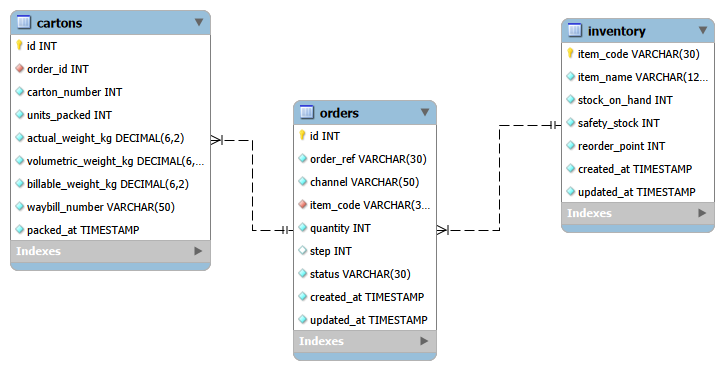

# FinFlow — Packing & Order Fulfilment Solution for Fintr (Group 28)

**Course:** BFB 321 — Supply Chain Digital Technologies  
**Academic Year:** 2026 | **Group:** Group 28  
**Client / Product:** Fintr (Pty) Ltd — FinMaster Board Game (`FM-2026-CN`)  
**Repository:** [https://github.com/u24590772/BFB-Group-28-Project.git](https://github.com/u24590772/BFB-Group-28-Project.git)

---

## 1. Team Members & Task Allocation (Rubric B6)

| Student Name | Student Number | GitHub Username | Allocated Project Responsibilities (Rubric B6.4) |
| :--- | :--- | :--- | :--- |
| **Zaid Varachia** | u24590772 | `u24590772` | **Data Model & Backend API:** MySQL 3NF schema, Aiven Cloud DB, Flask REST API CRUD, transactions (`FOR UPDATE`, rollback), runbook. |
| **Mulanga Dau** | u22678884 | `u22678884` | **Supply Chain Algorithms & Testing:** Pure Python model (`models/supply_chain.py`), EOQ/ROP, volumetric packaging logic, Pytest suite. |
| **Nicolas Mthombeni** | u22683552 | `Nicolas-techni` | **Frontend & UI Integration:** Jinja2 templates (`base.html`, `dashboard.html`, `sales_flow.html`), CSS styling, dynamic DOM updates (`sales_flow.js`, `dashboard.js`). |

---

## 2. Project Background & System Overview

Fintr sells **FinMaster**, scaling monthly demand from **32 to over 500 units/month**. Manual transcription between Takealot Websupplier, ERPNext, and The Courier Guy previously caused dispatch bottlenecks and a 12–18% transcription error rate.

**FinFlow provides a unified web fulfillment tool that:**
1. Tracks Takealot orders across an automated **7-Stage Sales Pipeline** (PO intake to courier dispatch).
2. Verifies stock availability against an enforced **50-unit safety buffer** before reserving.
3. Automatically computes **master carton splits** (max 4 games/carton) and **Courier Guy volumetric road-freight tariffs**.
4. Applies pure Python **Economic Order Quantity (EOQ = 306 units)** and **Reorder Point (ROP = 170 units)** models.

---

## 3. Database Architecture & ERD

Hosted on a managed **Aiven Cloud MySQL 8.0** cluster. Normalized to **3NF** with strict constraints and `created_at` / `updated_at` audit timestamps.



- **`inventory`:** Tracks master SKU, stock on hand, 50-unit safety stock, and reorder point.
- **`orders`:** Outbound orders across Takealot, Shopify, and Direct email; tracks Takealot pipeline stages (1 to 7).
- **`cartons`:** Physical box breakdown (max 4 units), billable weights (`DECIMAL(6,2)`), and generated Courier Guy waybills (`TCG-ZA-...`).

---

## 4. REST API Specification

All endpoints accept and return JSON with consistent response envelopes (`status`, `message`, `data`).

| Method | Endpoint | Description | Request Payload / Params | Status Codes |
| :--- | :--- | :--- | :--- | :--- |
| `GET` | `/api/inventory` | Read current stock, buffer, and EOQ metrics | None | `200` |
| `GET` | `/api/orders` | List orders with pagination & filtering | `?channel=Takealot&status=Pending&page=1&limit=5` | `200` |
| `POST` | `/api/orders` | Create an order with stock buffer check | `{"order_ref": "ORD-101", "channel": "Takealot", "quantity": 8}` | `201`, `400` |
| `GET` | `/api/orders/<id>` | Read single order by ID or order_ref | None | `200`, `404` |
| `PUT` | `/api/orders/<id>` | Update mutable order fields in MySQL | `{"quantity": 10, "status": "Pending"}` | `200`, `404` |
| `POST` | `/api/calculate-shipping` | Compute carton count & courier tariffs | `{"quantity": 8}` | `200`, `400` |
| `POST` | `/api/orders/<id>/pack` | Atomic packing transaction (deducts stock) | None | `200`, `409` |
| `GET` | `/api/sales-flow` | List Takealot orders active in 7-stage flow | None | `200` |
| `POST` | `/api/sales-flow/<id>/advance` | Advance order 1 step (auto-packs at Step 6) | None | `200`, `400`, `409` |

---

## 5. End-to-End User Flows

The application provides three complete, interactive user flows across the browser and database:

1. **Takealot 7-Stage Fulfilment & Dispatch (`/sales-flow`):** Operator advances Takealot orders. At Step 6 (Courier Booked), the system auto-packs cartons, assigns Courier Guy waybills, and deducts inventory stock in MySQL without a page reload.
2. **Order Intake & Buffer Check (`/dashboard`):** Form submits a new order to `POST /api/orders`. The backend validates requested quantity against the 50-unit safety buffer; approved orders immediately appear in the live queue; buffer breaches are rejected with clear error messages.
3. **Carton & Courier Freight Calculator (`/dashboard`):** Form queries `POST /api/calculate-shipping` to simulate master carton allocations (max 4 games/box), billable volumetric weight (`4,000 cm³/kg`), and Courier Guy road-freight tariffs (R 120 base + excess + 15% VAT).

---

## 6. Installation & Execution Runbook (Rubric B4)

Follow these steps to run the application on any computer with Python 3.8+:

```bash
# 1. Clone repository & navigate to directory
git clone https://github.com/u24590772/BFB-Group-28-Project.git
cd BFB-Group-28-Project

# 2. Set up virtual environment
python -m venv venv
# Windows:
venv\Scripts\activate
# macOS/Linux: source venv/bin/activate

# 3. Install dependencies
pip install -r requirements.txt

# 4. Environment configuration
# Copy template (configured for our live Aiven Cloud MySQL cluster)
cp .env.example .env

# 5. Initialize & seed demo database (one-step command)
python init_db.py --reset

# 6. Start the Flask web application
python app.py
```

### Accessing the Web Interface
- **Landing Hub:** [http://127.0.0.1:5000/](http://127.0.0.1:5000/)
- **Fulfilment Dashboard & Tools:** [http://127.0.0.1:5000/dashboard](http://127.0.0.1:5000/dashboard)
- **7-Stage Sales Flow Tracker:** [http://127.0.0.1:5000/sales-flow](http://127.0.0.1:5000/sales-flow)
- *Access Note:* Internal warehouse dispatcher portal (single-role operational workspace; no login wall required).

### Run Automated Tests (Pytest)
```bash
pytest -v
```
*(All 37 unit and integration tests run against pure Python models and the live cloud database).*

---

## 7. Database Operations, Backup & Rollback (Rubric B4.3)

* **Logical Backup:**
  ```bash
  mysqldump -h mysql-27f83ea4-bfbgroup28.h.aivencloud.com -P 20734 -u avnadmin -p defaultdb > backup.sql
  ```
* **Restore from Backup:**
  ```bash
  mysql -h mysql-27f83ea4-bfbgroup28.h.aivencloud.com -P 20734 -u avnadmin -p defaultdb < backup.sql
  ```
* **Fast Reset:** `python init_db.py --reset` resets MySQL back to pristine seed data at any time.
* **Concurrency & Rollback:** All state modifications use `SELECT ... FOR UPDATE` row locks. If any check fails, `conn.rollback()` executes automatically, preventing partial writes.
