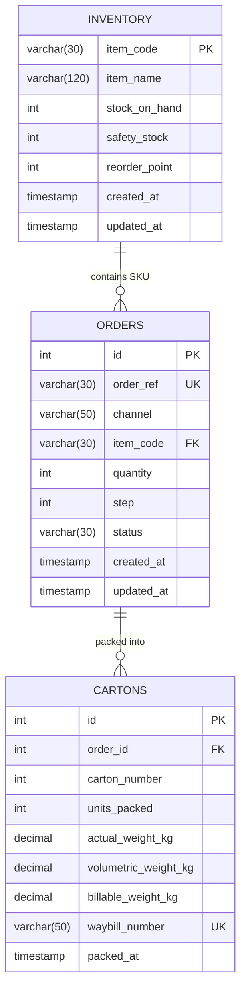

# FinFlow — Packing and Order Fulfilment Web Solution for Fintr (Group 28)

**Course:** BFB 321 — Supply Chain Digital Technologies  
**Academic Year:** 2026  
**Group:** Group 28  
**Client Project:** Fintr (FinMaster Board Game `FM-2026-CN`)  
**Stack:** Flask Backend • MySQL (Aiven Cloud) • HTML5/CSS3/Bootstrap • Standalone Supply Chain Model  

---

## 1. Group Members & Task Allocation

| Student Name | Student Number | GitHub Username | Allocated Project Responsibilities (Rubric B6.4) |
| :--- | :--- | :--- | :--- |
| **Zaid Varachia** | u24590772 | u24590772 | Step 3 (MySQL Data Model, Cloud DB), Step 4 (Flask REST API, CRUD, Transactions, Error Handlers), Step 6 (Config & Runbook) |
| **Mulanga Dau** | u22678884 | u22678884 | Step 2 (Standalone Python Supply Chain Model, EOQ/ROP, Carton Volumetric Calculation, Pytest Unit Tests) |
| **Nicolas Mthombeni** | u22683552 | u22683552 | Step 1 (Frontend HTML5/CSS3/Bootstrap UI, Templates, Responsive Card Grids, DOM Stage Transitions in `sales_flow.js`) |

---

## 2. Project Background & System Overview

**Fintr** manufactures and distributes **FinMaster** (`FM-2026-CN`), a South African financial education board game. As monthly sales scale from 32 units to over 500 units, administrative bottlenecks and manual transcription errors between Takealot Websupplier, ERPNext, and The Courier Guy risk parcel delays and costly reverse logistics.

**FinFlow** provides a unified fulfilment workspace that:
1. Replaces disjointed multi-portal data entry with an automated **7-Stage Takealot Sales Flow Tracker**.
2. Applies the standalone **Economic Order Quantity (EOQ)** and **Reorder Point (ROP)** model against live inventory.
3. Automatically computes **master carton splits** (max 4 games/carton) and **Courier Guy volumetric road-freight tariffs**.
4. Guarantees inventory integrity via **atomic MySQL transactions** with safety stock buffer enforcement.

---

## 3. Repository Architecture

```text
BFB-Group-28-Project/
├── config.py                   # Multi-environment configuration (Dev/Test/Prod) [Rubric B4.2]
├── db.py                       # Safe PyMySQL connection manager & teardown hook [Rubric B1.4]
├── db_queries.py               # Repository queries & atomic transactions (FOR UPDATE) [Rubric B2.2, B2.5]
├── init_db.py                  # One-command database provisioning & reset script [Rubric B1.3]
├── app.py                      # Flask backend, Jinja routes, REST API & error handlers [Rubric B2.1, B7.1]
├── requirements.txt            # Project dependencies (flask, pymysql, pytest, python-dotenv, cryptography)
├── .env.example                # Environment variables template (no hardcoded secrets) [Rubric B4.2]
├── database/                   # Step 3: MySQL Schema & Seed
│   ├── schema.sql              # 3NF DDL (inventory, orders, cartons) with audit fields & constraints [B1.1]
│   └── seed.sql                # Realistic synthetic demo data for immediate marking [B1.3]
├── models/                     # Step 2: Standalone Supply Chain Model [Rubric B7.1]
│   ├── __init__.py
│   └── supply_chain.py         # Pure Python formulas (EOQ, ROP, freight cost, carton breakdown)
├── templates/                  # Step 1: Responsive Jinja2 Frontend Templates
│   ├── base.html               # Master layout, responsive navigation & footer
│   ├── index.html              # Warehouse summary hub with live stock KPI cards
│   ├── dashboard.html          # EOQ inventory cards & outbound orders courier freight table
│   └── sales_flow.html         # Interactive 7-stage Takealot fulfilment pipeline
├── static/                     # Static styling and client-side logic
│   ├── css/
│   │   └── style.css           # Clean custom responsive CSS styling & badges
│   └── js/
│       └── sales_flow.js       # Asynchronous stage advancement (fetch API) with optimistic updates
└── tests/                      # Automated Test Suite (Pytest)
    ├── __init__.py
    ├── test_supply_chain.py    # Unit tests verifying EOQ, ROP, and courier tariff calculations
    └── test_app.py             # Integration tests verifying routes, REST API CRUD, and 3 E2E scenarios
```

---

## 4. Database Design & Entity Relationship Diagram (ERD)

The database is normalized to **Third Normal Form (3NF)** and hosted on a managed **Aiven Cloud MySQL** cluster.



### Key Schema Characteristics (Rubric B1.1):
- **Foreign Key Constraints:** `orders.item_code -> inventory.item_code` (`ON UPDATE CASCADE`), `cartons.order_id -> orders.id` (`ON DELETE CASCADE`).
- **Data Integrity Constraints:**
  - Non-negative stock: `CHECK (stock_on_hand >= 0)`
  - Order quantity: `CHECK (quantity > 0)`
  - Step range: `CHECK (step IS NULL OR (step BETWEEN 1 AND 7))`
  - Master carton physical limit: `CHECK (units_packed > 0 AND units_packed <= 4)`
- **Audit Trails:** `created_at` and `updated_at` automatically maintained on all primary entities.
- **Accurate Financial Data Types:** All parcel weights and courier costs utilize `DECIMAL(6,2)` (never binary floating-point).

---

## 5. REST API Specification (Rubric B2.1, B2.2, B2.4)

All API endpoints return consistent JSON responses with appropriate HTTP status codes (`200 OK`, `201 Created`, `400 Bad Request`, `404 Not Found`, `409 Conflict`).

| Method | Endpoint | Description | Request Body / Query Parameters | Response Status |
| :--- | :--- | :--- | :--- | :--- |
| `GET` | `/api/inventory` | Read warehouse stock, buffer, and EOQ parameters. | None | `200 OK` |
| `GET` | `/api/orders` | Read orders with filtering and pagination. | `?status=Pending&channel=Takealot&page=1&limit=5` | `200 OK` |
| `POST` | `/api/orders` | **Create** a new order with stock reservation check. | `{"order_ref": "ORD-101", "channel": "Takealot", "quantity": 8}` | `201 Created` / `400` |
| `GET` | `/api/orders/<id>` | **Read** one specific order by ID or order_ref. | None | `200 OK` / `404` |
| `PUT` | `/api/orders/<id>` | **Update** an existing order's quantity or details. | `{"quantity": 12}` | `200 OK` / `404` |
| `POST` | `/api/calculate-shipping` | Compute cartons & Courier Guy road-freight tariff. | `{"quantity": 8}` | `200 OK` / `400` |
| `POST` | `/api/orders/<id>/pack` | Atomic packing transaction: generates waybills & deducts stock in MySQL. | None | `200 OK` / `409` |
| `GET` | `/api/sales-flow` | Retrieve Takealot orders active in the 7-stage pipeline. | None | `200 OK` |
| `POST` | `/api/sales-flow/<id>/advance` | Advance order one stage in MySQL; auto-packs at Step 6. | None | `200 OK` / `409` |

---

## 6. Installation & Execution Runbook (Rubric B4.1)

Follow these exact steps on any machine with Python 3.8+ installed:

### Step 1: Clone Repository
```bash
git clone https://github.com/u24590772/BFB-Group-28-Project.git
cd BFB-Group-28-Project
```

### Step 2: Create and Activate Virtual Environment
```bash
# Windows:
python -m venv venv
venv\Scripts\activate

# macOS / Linux:
python3 -m venv venv
source venv/bin/activate
```

### Step 3: Install Required Dependencies
```bash
pip install -r requirements.txt
```

### Step 4: Configure Cloud Database Connection
Copy `.env.example` to `.env` (or use the provided pre-configured `.env` connecting to our live Aiven Cloud MySQL instance):
```bash
cp .env.example .env
```
Ensure `.env` contains:
```ini
DB_HOST=mysql-27f83ea4-bfbgroup28.h.aivencloud.com
DB_PORT=20734
DB_USER=avnadmin
DB_PASSWORD=your_aiven_password
DB_NAME=defaultdb
FLASK_ENV=development
```

### Step 5: Provision Database & Seed Demo Data (Rubric B1.3)
Run the automated initialization script to build tables and insert 8 realistic demo orders:
```bash
python init_db.py --reset
```

### Step 6: Start the Flask Web Server
```bash
python app.py
```
Open your browser at:
- **Landing Hub:** [http://127.0.0.1:5000/](http://127.0.0.1:5000/)
- **Fulfilment Dashboard:** [http://127.0.0.1:5000/dashboard](http://127.0.0.1:5000/dashboard)
- **7-Stage Sales Flow Tracker:** [http://127.0.0.1:5000/sales-flow](http://127.0.0.1:5000/sales-flow)

### Step 7: Run Automated Test Pack
Execute the Pytest test suite from the repository root:
```bash
pytest -v
```

---

## 7. Database Operations, Backup & Rollback (Rubric B4.3)

### Database Backup
To produce a full logical SQL backup from Aiven Cloud MySQL:
```bash
mysqldump -h mysql-27f83ea4-bfbgroup28.h.aivencloud.com -P 20734 -u avnadmin -p defaultdb > backup_finflow_$(date +%F).sql
```

### Database Restore
To restore from an existing SQL backup file:
```bash
mysql -h mysql-27f83ea4-bfbgroup28.h.aivencloud.com -P 20734 -u avnadmin -p defaultdb < backup_finflow_2026-11-10.sql
```

### Repeatable Fast Reset
To reset tables back to clean examination seed data at any time:
```bash
python init_db.py --reset
```

### Transaction Rollback Strategy (Rubric B2.5)
All state-modifying actions (`pack_order_transaction` and `advance_order_transaction`) are wrapped in strict `try ... except` blocks with database row locks (`SELECT ... FOR UPDATE`). If any step fails (such as insufficient stock, constraint violation, or duplicate waybill), `conn.rollback()` is immediately executed, leaving MySQL in an uncorrupted state.
